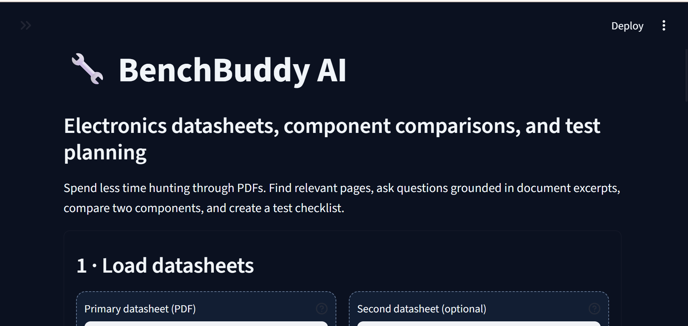
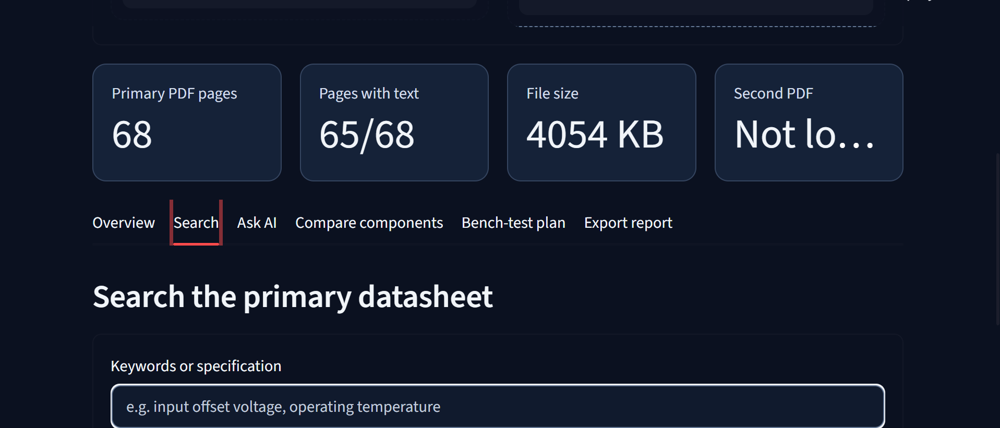
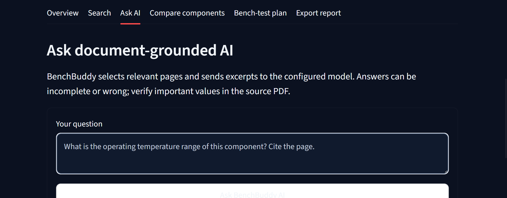
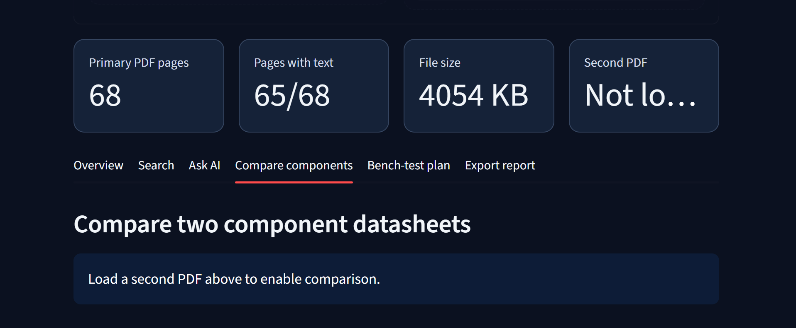

# BenchBuddy AI 🔧

**An AI-powered assistant for electronics datasheets and virtual bench-test planning.**

BenchBuddy AI helps electronics students and engineers explore component datasheets, find technical specifications, ask questions about uploaded documents, compare components, and prepare structured bench-test plans.

## 📸 Screenshots

### Dashboard

### Datasheet Search

### AI-Powered Questions

### Component Comparison

### Virtual Bench-Test Plan

